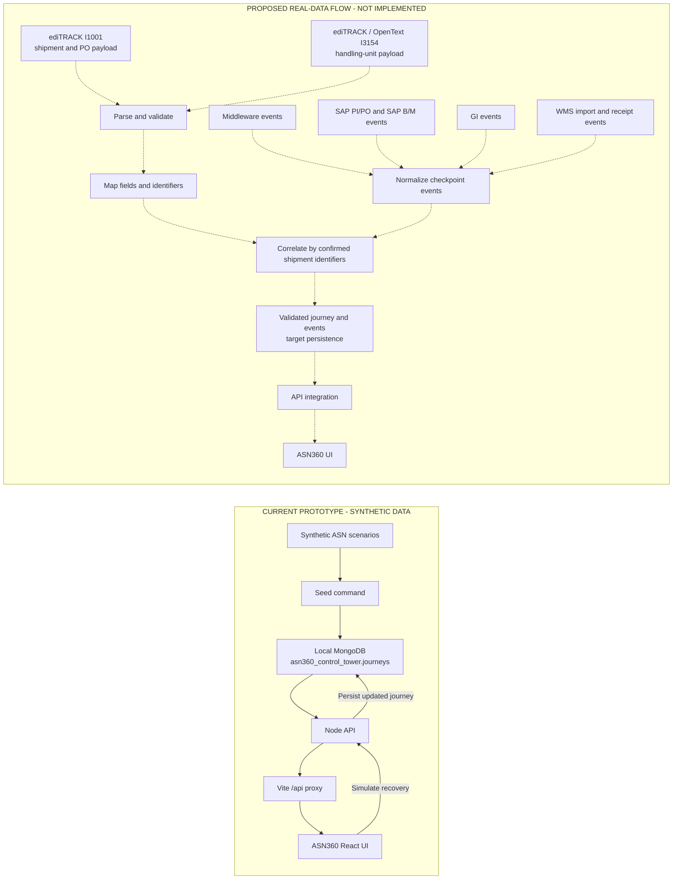
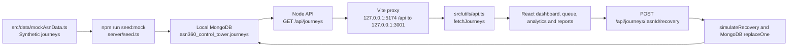
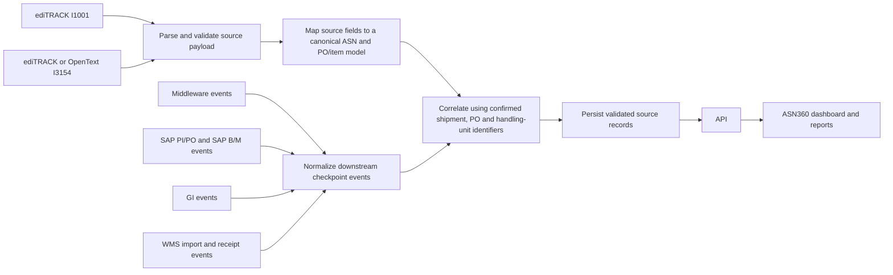

# ASN360 Data Flow and Attribute Mapping

## Purpose and scope

This document describes:

1. The structure of the sample ediTRACK and OpenText ASN messages.
2. The attribute relationships observed between the sample I1001 and I3154 payloads.
3. The data path implemented in the current ASN360 prototype.
4. A proposed path for integrating source and downstream system messages later.

The sample payloads were analyzed locally only. They were **not imported into MongoDB**, and the prototype does not currently ingest live ediTRACK, OpenText, Middleware, SAP, GI, or WMS data.

## At-a-glance data flow

The solid arrows show what is implemented in the prototype. The dotted arrows show a possible real-data path that has not been built. The supplied JSON files remain analysis-only.



**Legend:** solid arrows are implemented; dotted arrows are proposed. The proposed flow requires confirmed field mappings and cross-system correlation rules before source records can be safely joined into a journey.

## 1. Source message structures

### ediTRACK I1001

The I1001 message is organized around a container and its purchase orders:

```text
I1001 message
|-- Header
|   |-- MessageId, CreatedTimestamp, SourceApplicationName, InterfaceId
|   `-- BatchMessageCount, BatchRecordCount, BatchRecordSum
`-- Payload.Container
    |-- ASNID, ShipmentID, ShipmentMethod, dispatch and arrival dates
    `-- PurchaseOrder[]
        |-- PONumber, TransitReference, ShipmentTrackNumber
        |-- FreightForwarderDescription, destination and delivery fields
        `-- PackingList[]
            |-- EPLID, StatusType, PackType, NetWeight, milestone dates
            `-- Carton[]
                |-- CartonID, CartonRef, dimensions and weight
                `-- UPC[]
                    `-- ArticleNumber, LineID, UPC, UPCQuantity
```

### I3154

I3154 expresses a shipment as a load and handling-unit hierarchy:

```text
I3154 ShipmentNotification
|-- Header
|   |-- MessageId, CreatedTimestamp, SourceApplicationName, InterfaceId
|   `-- BatchMessageCount, BatchRecordCount, BatchRecordSum
`-- Payload.Shipment
    |-- ShipmentID, ContainerReference, ShipMethod, dispatch date
    `-- Load
        |-- estimated delivery date/time
        |-- EANLocation[] (supplier and ship-to locations)
        `-- MasterHandlingUnit[]
            `-- ChildHandlingUnit
                `-- ShippingUnitItem[]
                    `-- SOReferenceNumber, VariantArticle, LineNumber,
                        HandlingUnitNumber, DispatchQuantity, DispatchUOM
```

I3154 is not exclusive to one source in the samples: one I3154 message identifies ediTRACK and another identifies OpenText.

## 2. Observed I1001-to-I3154 mapping

The 2024 ediTRACK I1001 and I3154 samples describe the same shipment. Their message IDs, shipment/container identifiers, PO numbers, item attributes, and quantities align. The payloads establish a strong data correspondence; by themselves, they do not prove the actual integration mechanism or execution order.

| I1001 attribute | I3154 counterpart | Observed relationship |
|---|---|---|
| `Header.MessageId` | `Header.MessageId` | Same in the matched sample |
| `Container.ASNID` | `Shipment.ShipmentID` | Same identifier in the matched sample |
| `Container.ShipmentID` | `Shipment.ContainerReference` | Same container reference in the matched sample |
| `PurchaseOrder.PONumber` | `ShippingUnitItem.SOReferenceNumber` | Exact PO match |
| `PurchaseOrder.FinalDestinationWarehouseCode` | `Load.EANLocation` where type is `SH` | Exact warehouse-code match |
| `PurchaseOrder.DeliveryDateToFinalWarehouse` | `Load.EstimatedDeliveryDate` | Same date in the matched sample |
| `PurchaseOrder.DeliveryTimeToFinalWarehouse` | `Load.EstimatedDeliveryTime` | Same time in the matched sample |
| `Carton.CartonID` | `ShippingUnitItem.HandlingUnitNumber` | Exact handling-unit match |
| `UPC.ArticleNumber` | `ShippingUnitItem.VariantArticle` | Exact article match |
| `UPC.UPC` | `ShippingUnitItem.LineNumber` | Matches after removing left-padding zeroes in the sample; retain both source strings until mapping rules are confirmed |
| `UPC.UPCQuantity` | `ShippingUnitItem.DispatchQuantity` | Exact quantity match |
| `PackingList.PackType` | Child `PackagingMaterialsType` | Both are `B` in the matched sample, but apply at different hierarchy levels |
| `PackingList.NetWeight` | Child `HULoadWeight` | Same numeric value in the sample; unit and field scope must be confirmed |
| `Carton.CartonGrossWeight` | Child `UnitofWeight` | Sample values differ by a factor of 1,000; likely a unit/scale difference, not yet a confirmed conversion |

### Attributes without a confirmed one-to-one mapping

| I1001 attribute | Observation |
|---|---|
| `FreightForwarderDescription` | No direct equivalent is established. I3154 `CarrierName` matches the I1001 vessel name in the matched sample, not the freight-forwarder description. |
| `ShipmentTrackNumber` | No direct equivalent was identified in the matched I3154 payload. |
| `PackingList.EPLID` | No direct equivalent was identified. |
| `SeriesNumber` | I1001 has `03028`; the I3154 supplier location is `M03028`. This is a possible relationship, not an exact match. |
| `StatusType` / `TransactionType` | Both contain `N` in the matched sample, but they are different fields at different levels. The code meaning needs a source-system codebook. |

## 3. Reconciliation results from the samples

For the matched 2024 sea shipment:

- Seven purchase orders are represented in both messages.
- All 1,448 carton/item records match by PO, handling-unit/carton ID, article, and quantity.
- The records total 25,472 product units in both representations.
- Each PO has one article in this sample.

| PO | Cartons / handling units | Product quantity |
|---|---:|---:|
| 2012534603 | 164 | 3,280 |
| 2012534614 | 135 | 2,700 |
| 2012534616 | 305 | 6,100 |
| 2012534630 | 168 | 2,016 |
| 2012534647 | 84 | 1,008 |
| 2012545753 | 184 | 2,208 |
| 2012583908 | 408 | 8,160 |
| **Total** | **1,448** | **25,472** |

### Count fields are not interchangeable

The samples use batch counts and sums at different apparent grains:

| Sample | Header count/sum | Payload-level detail | Interpretation to validate |
|---|---|---|---|
| 2024 ediTRACK I1001 | `BatchRecordCount` 1,448; `BatchRecordSum` 25,472 | 1,448 carton/UPC records; quantity total 25,472 | Count aligns to records; sum aligns to product quantity |
| 2024 ediTRACK I3154 | `BatchRecordCount` 1; `BatchRecordSum` 1,448 | One shipment with 1,448 handling units/items | Count appears message/shipment-level; sum aligns to handling units |
| 2025 ediTRACK I1001 | `BatchRecordCount` 37; `BatchRecordSum` 3,522 | 33 cartons, 37 UPC lines, quantity total 3,522 | Count aligns to item lines rather than unique cartons |
| 2026 OpenText I3154 | `BatchRecordCount` 1; `BatchRecordSum` 4 | Four handling units/item lines, dispatch quantity total 74 | The value 4 appears to count handling units, not product units |

Do not treat `BatchRecordCount`, `BatchRecordSum`, carton count, handling-unit count, item-line count, and product quantity as equivalent measures.

## 4. Current prototype data flow (implemented)

The current UI uses synthetic records. It does not parse the sample JSON files.



Relevant implementation:

- `src/data/mockAsnData.ts` defines synthetic scenarios.
- `server/seed.ts` upserts the synthetic journeys into the `journeys` collection.
- `server/index.ts` provides the API and persists simulated recovery updates.
- `src/utils/api.ts` loads journey data and sends recovery requests.
- `vite.config.ts` proxies frontend `/api` requests to the local API.

Default local settings:

| Setting | Default |
|---|---|
| MongoDB URI | `mongodb://127.0.0.1:27017` |
| Database | `asn360_control_tower` |
| Collection | `journeys` |
| API | `http://127.0.0.1:3001` |
| Frontend | `http://127.0.0.1:5174` |

Running `npm run seed:mock` again replaces matching demo journeys with their original synthetic versions, including resetting simulated recovery changes.

## 5. Proposed real-data flow (not implemented)



This is a target design, not current behavior. No source-payload parser, import endpoint, live connector, or downstream event feed is implemented. The current MongoDB `journeys` collection contains the prototype's `AsnJourney` records, not the uploaded source messages.

The source ASN payload alone can provide shipment, PO, carton/handling-unit, article, quantity, and planned/actual shipment milestones where present. It does **not** prove that Middleware, SAP PI/PO, SAP B/M, GI, or WMS processed or received the shipment. Those systems need to provide their own timestamped event evidence, correlated to the ASN.

## 6. Decisions needed before a real importer

1. Confirm the semantics of `StatusType` / `TransactionType` codes, including `N`.
2. Confirm whether `SeriesNumber` corresponds to the supplier location code.
3. Define whether UPC-to-line-number padding can be normalized and how the original identifiers are retained.
4. Confirm weight units and whether `NetWeight` / `HULoadWeight` are PO-, load-, or handling-unit-level values.
5. Define count and sum semantics for each interface version.
6. Confirm timestamp timezone and distinguish port arrival, estimated warehouse delivery, and actual WMS receipt.
7. Obtain downstream event examples and the stable identifiers used to correlate Middleware, SAP PI/PO, SAP B/M, GI, and WMS records.

Until these definitions and source interfaces are agreed, keep the sample payloads separate from the synthetic demo data and label all sample-derived values as unvalidated.
